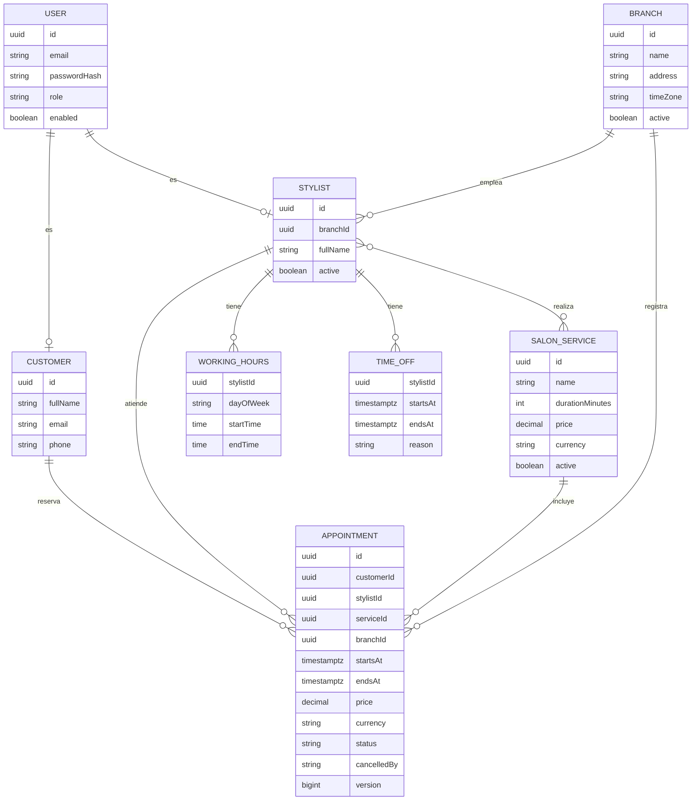
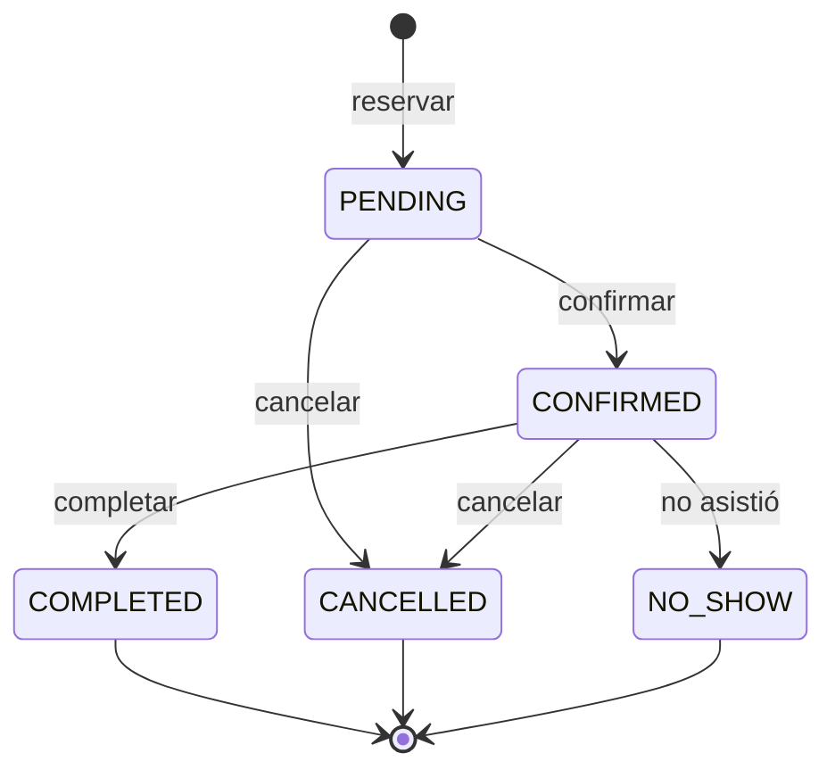

# Modelo de dominio

## Módulos (bounded contexts)

| Módulo | Responsabilidad |
|---|---|
| `identity` | Usuarios, credenciales y roles (`ADMIN`, `STYLIST`, `CUSTOMER`). |
| `branch` | Sedes del salón (nombre, dirección, zona horaria). |
| `catalog` | Servicios del salón (`SalonService`). |
| `staff` | Estilistas, horarios laborales, ausencias y servicios que realizan. |
| `booking` | Citas, cálculo de disponibilidad y ciclo de vida de la cita. **Núcleo del negocio.** |
| `notification` | Envío de notificaciones (email). |

> La entidad del catálogo se llama `SalonService` (y no `Service`) para no confundirla con
> la anotación `@Service` de Spring ni con los servicios de la capa de aplicación.

## Diagrama de entidades

> `USER` y sus relaciones se implementan en la Fase 4. `WORKING_HOURS` y `TIME_OFF` son value objects
> del estilista, por lo que no tienen identificador propio.

## Value objects

Son inmutables (`record` de Java) y se validan al construirse: no puede existir un value object inválido.

| Value object | Contenido | Comportamiento |
|---|---|---|
| `TimeSlot` | `start`, `end` (`Instant`) | `overlapsWith(TimeSlot)`, `duration()`; exige `start < end` |
| `Money` | `amount` (`BigDecimal`), `currency` | Escala 2, no negativo, operaciones aritméticas seguras |
| `Email` | `value` | Formato válido, normalizado en minúsculas |
| `PhoneNumber` | `value` | Formato E.164 (por ejemplo `+593991234567`) |
| `*Id` | `UUID` | Identificadores tipados (`AppointmentId`, `StylistId`...) para evitar mezclar IDs |

## Ciclo de vida de la cita

Las transiciones se implementan como métodos de la entidad `Appointment` (`confirm()`, `cancel()`,
`complete()`, `markNoShow()`); el modelo es **rico**, no anémico.
