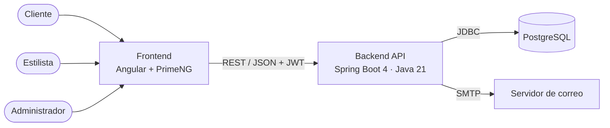
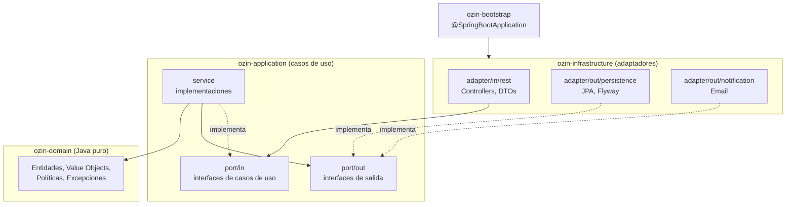

# Arquitectura

## Vista de contenedores (C4 nivel 2)



## Arquitectura hexagonal del backend

El backend es un **monolito modular** con arquitectura hexagonal (puertos y adaptadores),
separado en módulos Maven para que **el compilador** haga cumplir las dependencias.



### Módulos Maven

| Módulo | Depende de | Contenido | Dependencias externas permitidas |
|---|---|---|---|
| `ozin-domain` | — | Entidades, value objects, políticas, excepciones de dominio | **Ninguna** (Java puro) |
| `ozin-application` | `domain` | Puertos de entrada/salida, servicios de casos de uso | Ninguna de Spring |
| `ozin-infrastructure` | `application` | Controllers REST, persistencia JPA, seguridad, email | Spring, JPA, etc. |
| `ozin-bootstrap` | `infrastructure` | Clase principal, configuración, ensamblado de beans | Spring Boot |

### Reglas de dependencia

1. `domain` no conoce nada externo: ni Spring, ni JPA, ni Jackson.
2. `application` solo conoce `domain` y define **puertos** (interfaces).
3. `infrastructure` implementa los puertos de salida (**adaptadores**) e invoca los puertos de entrada.
4. Las entidades JPA son distintas de las entidades de dominio; se mapean en el adaptador.
5. Estas reglas se verifican con tests de **ArchUnit**, además de la separación por módulos Maven.

### Estructura de paquetes

```
com.ozin.domain.<modulo>                       entidades, value objects, políticas
com.ozin.application.<modulo>.port.in          interfaces de casos de uso
com.ozin.application.<modulo>.port.out         interfaces de salida (repositorios, notificaciones)
com.ozin.application.<modulo>.service          implementaciones de casos de uso
com.ozin.infrastructure.<modulo>.adapter.in.rest
com.ozin.infrastructure.<modulo>.adapter.out.persistence
com.ozin.infrastructure.config / security
```

### Decisiones de implementación

- **Transacciones:** se delimitan con el puerto `UnitOfWork` (ADR-0007).
- **Registro de casos de uso:** `UseCaseConfig` detecta las clases `*Service` de `application` por convención
  de paquete y nombre; esa capa no lleva anotaciones de Spring.
- **Modelo de lectura:** los listados usan `AppointmentView`, una proyección que evita cargar cada agregado para mostrar nombres.
- **Mapeo:** manual, con métodos pequeños en cada adaptador. Es explícito y solo hay unos pocos campos por entidad.
- **Errores:** `GlobalExceptionHandler` responde con RFC 9457 (`application/problem+json`) y un `code` estable.

| Situación | HTTP |
|---|---|
| Datos inválidos | 400 |
| Sin sesión, token inválido o credenciales incorrectas | 401 |
| Sin permiso sobre la ruta o sobre el recurso | 403 |
| Recurso inexistente | 404 |
| Demasiados intentos de inicio de sesión | 429 |
| Horario ocupado (RN-01), email repetido, transición de estado inválida, modificación concurrente | 409 |
| Otra regla de negocio incumplida (RN-02 a RN-08) | 422 |

## SOLID en Ozin

| Principio | Aplicación concreta |
|---|---|
| **S**ingle Responsibility | Un servicio por caso de uso (`CreateAppointmentService`, `CancelAppointmentService`). Los controllers solo traducen HTTP. |
| **O**pen/Closed | `CancellationPolicy` y `BookingPolicy` como interfaces; una política nueva no modifica las existentes. |
| **L**iskov Substitution | Cualquier `NotificationPort` (email, log, fake para tests) es intercambiable sin alterar el comportamiento esperado. |
| **I**nterface Segregation | Puertos pequeños: `LoadAppointmentPort`, `SaveAppointmentPort`, `LoadStylistPort`... cada caso de uso pide solo lo que usa. |
| **D**ependency Inversion | Los casos de uso dependen de puertos; Spring inyecta los adaptadores desde `infrastructure`. |

## Arquitectura del frontend

```
frontend/src/app/
├── core/        API, autenticación, interceptor, guards, errores, hora de la sede (singletons)
├── shared/      agenda y componentes UI reutilizados por varias features
└── features/
    ├── home/      portada y catálogo
    ├── auth/      inicio de sesión y registro
    ├── booking/   flujo de reserva
    ├── customer/  mis citas
    ├── stylist/   agenda del estilista
    └── admin/     catálogo, estilistas, horarios, agenda general
        ├── data-access/  estado propio de la feature (signals)
        └── pages/        pantallas (rutas lazy)
```
